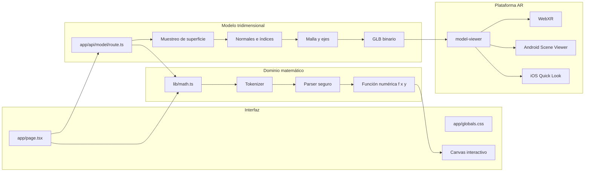
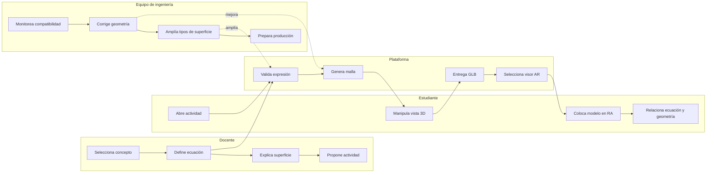
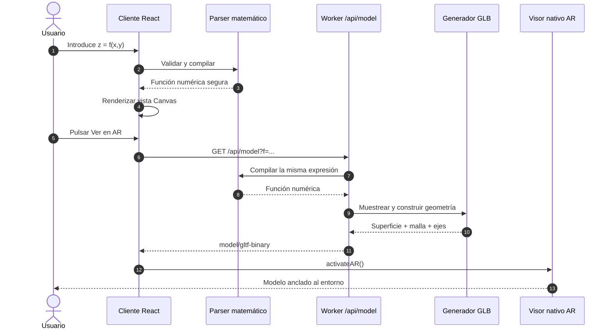

# VectorLab AR

Plataforma educativa de cálculo vectorial que transforma ecuaciones matemáticas en superficies 3D interactivas y modelos de realidad aumentada para iOS y Android.

> **Estado:** prototipo funcional / validación tecnológica. No debe considerarse todavía un producto listo para operación académica general.

## Contenido

- [Objetivo](#objetivo)
- [Subobjetivos](#subobjetivos)
- [Alcance actual](#alcance-actual)
- [Inicio rápido](#inicio-rápido)
- [Cómo probar realidad aumentada](#cómo-probar-realidad-aumentada)
- [Arquitectura](#arquitectura)
- [Diagramas de carriles](#diagramas-de-carriles)
- [Decisiones iniciales](#decisiones-iniciales)
- [Estructura del repositorio](#estructura-del-repositorio)
- [Limitaciones conocidas](#limitaciones-conocidas)
- [Ruta hacia producción](#ruta-hacia-producción)
- [Guía de contribución](#guía-de-contribución)

## Objetivo

Facilitar la comprensión de conceptos de cálculo vectorial mediante la generación, manipulación y proyección en realidad aumentada de superficies matemáticas tridimensionales desde un teléfono, una tableta o un navegador web.

El prototipo está alineado inicialmente con el programa de **Cálculo Vectorial ACF-0904 del Tecnológico Nacional de México**.

## Subobjetivos

1. Convertir una expresión de la forma `z = f(x, y)` en una superficie discretizada.
2. Permitir que el estudiante explore la superficie mediante rotación y acercamiento.
3. Generar un modelo binario glTF (`.glb`) en tiempo real.
4. Conservar malla y ejes X/Y/Z dentro del modelo exportado.
5. Abrir el modelo en RA mediante WebXR, Android Scene Viewer o iOS Quick Look.
6. Validar la utilidad didáctica antes de construir gestión académica, persistencia o evaluación.

## Alcance actual

### Incluido

- Cinco superficies precargadas: onda sinusoidal, paraboloide, silla de montar, campana y ondas radiales.
- Captura de expresiones personalizadas `z = f(x, y)`.
- Analizador matemático propio, sin `eval` ni ejecución arbitraria.
- Operadores `+`, `-`, `*`, `/`, `^`, paréntesis y constante `pi`.
- Funciones `sin`, `cos`, `tan`, `sqrt`, `abs`, `exp` y `log`.
- Visualización 3D ligera mediante Canvas 2D y proyección propia.
- Rotación, zoom y opción para ocultar la malla en la vista web.
- Generación dinámica de archivos GLB.
- Malla tridimensional y flechas de ejes incorporadas al GLB.
- Lanzamiento de RA con `<model-viewer>`.
- Diseño adaptable para escritorio y dispositivos móviles.

### Fuera del alcance actual

- Superficies paramétricas e implícitas completas.
- Elipsoides cerrados, toros o superficies con varias ramas.
- Persistencia de ejercicios, cuentas, grupos o progreso académico.
- Panel administrativo o docente.
- Evaluaciones, analítica de aprendizaje o LMS.
- Etiquetas tridimensionales en los ejes.
- Garantía de comportamiento homogéneo entre todos los dispositivos iOS y Android.

## Inicio rápido

### Requisitos

- Node.js `>= 22.13.0`
- npm incluido con Node.js
- Git
- Un navegador moderno

Comprueba las versiones:

```bash
node --version
npm --version
git --version
```

### Instalación

```bash
git clone https://github.com/karlozvx25/VectorLab-AR.git
cd VectorLab-AR
npm ci
```

### Desarrollo local

```bash
npm run dev
```

Abre la dirección que muestre la terminal, normalmente `http://localhost:3000`. Si el puerto está ocupado, el servidor seleccionará el siguiente disponible.

### Validación

```bash
npm run build
npm test
```

`npm run build` genera el Worker compatible con Cloudflare en `dist/`. `npm test` vuelve a construir y comprueba el renderizado principal y la ausencia del starter original.

### Comandos disponibles

| Comando | Uso |
|---|---|
| `npm run dev` | Servidor local con recarga automática |
| `npm run build` | Construcción de producción con vinext |
| `npm run start` | Ejecuta localmente la construcción generada |
| `npm test` | Construye y ejecuta pruebas de humo |
| `npm run lint` | Reglas estáticas de TypeScript y React |
| `npm run db:generate` | Reservado para futuras migraciones D1/Drizzle |

## Cómo probar realidad aumentada

La vista 3D funciona en escritorio mediante HTTP local. Las funciones de cámara/RA requieren un contexto seguro (`HTTPS`) y hardware compatible.

1. Despliega la aplicación en un dominio HTTPS o utiliza un túnel HTTPS de desarrollo.
2. Abre el enlace directamente en **Safari** para iPhone/iPad o **Chrome** para Android.
3. Selecciona o genera una superficie.
4. Pulsa **Ver en AR**.
5. Acepta el permiso de cámara.
6. Detecta una superficie horizontal, coloca el modelo y manipúlalo.

Evita abrir la prueba desde navegadores integrados en aplicaciones de mensajería. En iOS, si el visor no inicia, usa **Compartir → Abrir en Safari**.

## Arquitectura

La aplicación utiliza una arquitectura web sin base de datos en esta etapa:

- **UI:** React 19, App Router compatible con Next.js y estilos CSS propios.
- **Runtime:** vinext sobre Vite y Cloudflare Workers.
- **Matemáticas:** parser recursivo descendente en `lib/math.ts`.
- **Vista previa:** Canvas 2D que proyecta una malla 3D sin depender de WebGL.
- **Generación 3D:** endpoint Edge que muestrea la función y construye un GLB binario.
- **Realidad aumentada:** `<model-viewer>` selecciona WebXR, Scene Viewer o Quick Look.
- **Hosting actual:** OpenAI Sites sobre infraestructura compatible con Cloudflare.

### Flujo de datos

1. El usuario selecciona o escribe una expresión.
2. El parser valida y compila la expresión a una función numérica segura.
3. El visor web muestrea la función sobre una cuadrícula regular.
4. Canvas proyecta y pinta las celdas según profundidad.
5. Al preparar RA, `/api/model` vuelve a muestrear la misma expresión.
6. El endpoint genera posiciones, normales, índices, malla y ejes.
7. El resultado se empaqueta como GLB y se entrega a `<model-viewer>`.
8. El sistema operativo abre el modo AR disponible.

## Diagramas de carriles

Los diagramas usan [Mermaid](https://mermaid.js.org/) y se renderizan directamente en GitHub.

### Carriles de dependencias



### Carriles de usuarios



### Carriles de arquitectura y ejecución



## Decisiones iniciales

| Decisión | Motivo | Consecuencia |
|---|---|---|
| Aplicación web antes que app nativa | Validar rápido en varias plataformas | Existen diferencias entre visores iOS y Android |
| `z = f(x,y)` como primer modelo | Es el caso más directo para cálculo multivariable | No representa por sí solo superficies cerradas |
| Parser propio sin `eval` | Evitar ejecución arbitraria de JavaScript | Solo se admite un subconjunto matemático controlado |
| Vista previa Canvas propia | Prototipo ligero y control didáctico | No sustituye un motor 3D completo |
| GLB generado en tiempo real | La ecuación produce un activo portable | El endpoint recalcula el modelo por solicitud |
| Geometría basada en triángulos | Compatibilidad con Scene Viewer y Quick Look | Malla y ejes aumentan el número de vértices |
| Malla incluida en el GLB | Evitar que desaparezca en RA | Debe corregirse el offset normal en pendientes fuertes |
| `<model-viewer>` como puente | Unificar WebXR, Android e iOS | La manipulación final depende del visor nativo |
| Sin persistencia en el MVP | Concentrar la validación en geometría y RA | Aún no existen usuarios, cursos ni actividades guardadas |

## Estructura del repositorio

```text
VectorLab-AR/
├── app/
│   ├── api/model/route.ts    # Generación dinámica del GLB
│   ├── globals.css           # Diseño adaptable
│   ├── layout.tsx            # Metadatos y layout raíz
│   └── page.tsx              # UI, Canvas y lanzamiento AR
├── lib/
│   └── math.ts               # Tokenizer y parser matemático seguro
├── public/                   # Iconos y tarjeta social
├── tests/                    # Pruebas de humo del artefacto construido
├── worker/index.ts           # Entrada de Cloudflare Worker
├── vite.config.ts            # vinext, Sites y Cloudflare local
├── .openai/hosting.json      # Enlace lógico al despliegue de Sites
└── package.json
```

Los directorios `db/`, `drizzle/` y `examples/d1/` provienen del scaffold y están reservados para la futura capa de persistencia. No participan en el flujo actual.

## Limitaciones conocidas

### Geometría

- La malla se eleva actualmente en dirección vertical. En conos o pendientes pronunciadas puede quedar dentro de la superficie. Debe desplazarse según la **normal local**.
- Solo se generan superficies explícitas `z = f(x,y)`.
- El recorte de valores extremos evita modelos degenerados, pero puede ocultar singularidades.
- Los intervalos X/Y están fijados actualmente en `[-4, 4]`.
- No hay etiquetas X/Y/Z dentro del GLB.

### Experiencia móvil

- Android Scene Viewer ofrece una manipulación más fluida que Quick Look en los dispositivos probados.
- La escala, colocación y gestos finales dependen del visor del sistema operativo.
- Navegadores embebidos pueden bloquear la cámara o el salto al visor nativo.
- Se necesita una matriz formal de dispositivos y versiones de sistema operativo.

### Producto

- No existe persistencia ni autenticación propia de la aplicación.
- No hay observabilidad, métricas, telemetría ni captura estructurada de errores.
- No se han realizado pruebas de accesibilidad ni evaluación formal con estudiantes.
- El repositorio aún no declara licencia de uso; debe definirse antes de aceptar contribuciones externas.

## Ruta hacia producción

### Fase 1 — Robustez geométrica

- Offset de malla por normal local.
- Normales consistentes y detección de discontinuidades.
- Intervalos y resolución configurables.
- Pruebas unitarias del parser y del GLB.
- Validación automática con glTF Validator.

### Fase 2 — Superficies matemáticas

- Curvas y superficies paramétricas.
- Elipsoides, esferas, cilindros, conos cerrados y toros.
- Superficies implícitas mediante Marching Cubes.
- Planos de corte, curvas de nivel, gradiente y vectores normales.

### Fase 3 — Experiencia educativa

- Catálogo alineado al temario.
- Instrucciones y actividades guiadas.
- Modos docente y estudiante.
- Guardado y compartición de escenas.
- Accesibilidad y soporte bilingüe.

### Fase 4 — Plataforma

- Persistencia, identidad y autorización.
- Cursos, grupos, actividades y progreso.
- Observabilidad y analítica de uso.
- Políticas de privacidad, cámara y retención.
- CI/CD, entornos de desarrollo, pruebas y producción.

### Fase 5 — Piloto y lanzamiento

- Matriz de pruebas iOS/Android.
- Piloto con docentes y estudiantes.
- Métricas de desempeño y aprendizaje.
- Corrección de hallazgos críticos.
- Manuales, capacitación y soporte operativo.

## Guía de contribución

1. Crea una rama desde `main`:

   ```bash
   git switch -c feat/nombre-corto
   ```

2. Mantén cambios pequeños y enfocados.
3. Ejecuta antes de abrir un pull request:

   ```bash
   npm run build
   npm test
   npm run lint
   ```

4. En cambios de geometría o RA, adjunta la ecuación, dispositivo, versión del sistema, navegador, resultado esperado y observado, y una grabación cuando sea posible.
5. No agregues secretos, tokens, archivos `.env` ni credenciales de despliegue.

### Convenciones sugeridas

- `feat/`: nueva capacidad.
- `fix/`: corrección.
- `docs/`: documentación.
- `test/`: pruebas.
- `refactor/`: cambio interno sin nueva funcionalidad.

## Despliegue

El prototipo actual utiliza OpenAI Sites. `.openai/hosting.json` contiene únicamente el identificador lógico del proyecto y declaraciones opcionales de D1/R2; las credenciales nunca deben almacenarse en el repositorio.

Para otros proveedores, el equipo deberá conservar un runtime compatible con Cloudflare Workers o adaptar la salida de vinext.

## Propiedad y licencia

Proyecto iniciado por SyborX como prototipo educativo. La licencia todavía no ha sido definida. Hasta que se agregue un archivo `LICENSE`, el código conserva todos los derechos de su titular y no debe asumirse permiso de redistribución externa.
